# Portfólio Profissional — Bernardo Machado

> Portfólio acadêmico e profissional desenvolvido para o **Laboratório 01 de Desenvolvimento e Integração de Aplicações Web (DIAW)** da PUC Minas. O projeto apresenta formação, interesses, projetos, experiências e canais de contato em uma interface responsiva, acessível e preparada para deploy na Vercel.


---

## Índice

- [Links úteis](#links-úteis)
- [Sobre o projeto](#sobre-o-projeto)
- [Funcionalidades principais](#funcionalidades-principais)
- [Planejamento e Sprints](#planejamento-e-sprints)
- [Tecnologias utilizadas](#tecnologias-utilizadas)
- [Arquitetura](#arquitetura)
- [Protótipos e wireframes](#protótipos-e-wireframes)
- [Instalação e execução](#instalação-e-execução)
- [Deploy na Vercel](#deploy-na-vercel)
- [Estrutura de pastas](#estrutura-de-pastas)
- [Demonstração](#demonstração)
- [Testes e validações](#testes-e-validações)
- [Checklist da atividade](#checklist-da-atividade)
- [Autor](#autor)
- [Licença](#licença)

---

## Links úteis

- **Repositório:** https://github.com/BernardoRibeiro7/portfolio-profissional
- **Site publicado:** `ADICIONE_AQUI_O_LINK_DA_VERCEL_APÓS_O_DEPLOY`
- **Protótipo no Figma:** https://www.figma.com/design/Ntrx6bs4vuNTF4XjJOJSbd/LAB01---Portf%C3%B3lio-Profissional---Bernardo-Machado?node-id=0-1&t=PpDM1ML3ZNzTKsk0-1
- **Instruções de deploy:** [`DEPLOY_VERCEL.md`](DEPLOY_VERCEL.md)
- **Importação dos wireframes no Figma:** [`docs/FIGMA_IMPORT.md`](docs/FIGMA_IMPORT.md)

> O deploy não foi executado neste pacote porque será realizado pelo próprio autor na Vercel.

---

## Sobre o projeto

O objetivo é apresentar a trajetória de **Bernardo Machado** de forma moderna e acessível. O site foi construído como uma aplicação de página única, com navegação por seções, mantendo todos os conteúdos exigidos pelo laboratório.

O portfólio contém:

- apresentação pessoal em **português e inglês**;
- formação, área de atuação, interesses e objetivos profissionais;
- linha do tempo de projetos do mais antigo ao mais recente;
- tecnologias, descrições, imagens e links de repositório para cada projeto;
- experiências profissionais e acadêmicas;
- canais de contato clicáveis;
- formulário com validação no front-end e no back-end;
- integração opcional com serviço de e-mail via função serverless;
- layout responsivo para desktop, tablet e celular.

### Captura da versão final

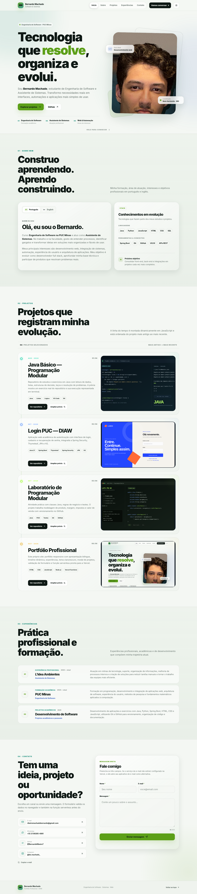

---

## Funcionalidades principais

- **Sobre mim bilíngue:** alternância entre português e inglês com abas acessíveis.
- **Timeline dinâmica:** projetos armazenados em JavaScript e renderizados do mais antigo ao mais recente.
- **Projetos completos:** nome, descrição, tecnologias, imagem de prévia e link para o GitHub.
- **Visualização ampliada:** modal para abrir as imagens dos projetos sem sair do portfólio.
- **Experiências:** empresa/instituição, função, período e descrição.
- **Contatos clicáveis:** e-mail, WhatsApp, GitHub e Instagram.
- **Formulário funcional:** nome, e-mail e mensagem, com validação no navegador e na API.
- **Back-end serverless:** rota `POST /api/contact` preparada para a Vercel.
- **Envio de e-mail:** suporte à API do Resend quando a variável `RESEND_API_KEY` estiver configurada.
- **Fallback:** se o envio direto estiver indisponível, o site abre o aplicativo de e-mail do visitante.
- **Tema claro/escuro:** preferência salva no navegador.
- **Menu responsivo:** navegação adaptada para telas menores.
- **Acessibilidade:** HTML semântico, labels, ARIA, foco visível, link de salto e suporte a `prefers-reduced-motion`.
- **Usabilidade:** scroll spy, indicador de progresso, botão de voltar ao topo, contador da mensagem e feedback de cópia/envio.

---

## Planejamento e Sprints

### Sprint 01 — Planejamento e prototipação

**Tecnologias previstas:**

- HTML5
- CSS3
- JavaScript
- Node.js para a função de contato
- Git / GitHub
- Vercel para hospedagem

**Entregas presentes no repositório:**

- estrutura inicial do projeto;
- menu e navegação entre seções;
- layout principal com cabeçalho, conteúdo e rodapé;
- wireframes de média fidelidade em `docs/wireframes/`;
- board único pronto para importação no Figma;
- descrição, arquitetura e organização no README.

### Sprint 02 — Funcionalidades principais

- Sobre mim em português e inglês;
- timeline dinâmica de projetos;
- experiências organizadas;
- canais de contato;
- formulário com validações;
- back-end de contato;
- responsividade e acessibilidade.

### Sprint 03 — Finalização

- refinamento visual e de usabilidade;
- imagens dos projetos;
- modal de visualização;
- documentação final;
- configuração de deploy pronta para Vercel;
- validações locais concluídas.

O único passo externo desta Sprint é publicar o repositório na Vercel e colar o link gerado neste README.

---

## Tecnologias utilizadas

### Front-end

- **HTML5** — estrutura semântica;
- **CSS3** — Grid, Flexbox, responsividade, variáveis, animações e temas;
- **JavaScript ES6+** — timeline, menu, abas, tema, modal, validação, scroll spy e interações.

### Back-end

- **Node.js 18+**;
- **Vercel Functions**;
- API HTTP do **Resend** para envio direto de e-mail, opcional.

### Infraestrutura

- Git;
- GitHub;
- Vercel.

### Dependências e bibliotecas

O projeto **não possui dependências NPM obrigatórias**. Todo o front-end e o servidor local usam recursos nativos da plataforma, reduzindo instalação e complexidade.

O serviço Resend é consumido por `fetch`, sem SDK externo.

---

## Arquitetura

A aplicação utiliza uma arquitetura simples, adequada a um portfólio:

1. `index.html` define a estrutura semântica da interface.
2. `assets/css/styles.css` concentra identidade visual e responsividade.
3. `assets/js/main.js` controla interações e renderiza os projetos dinamicamente.
4. O formulário envia uma requisição `POST` para `/api/contact`.
5. `api/contact.js` recebe a requisição na Vercel.
6. `lib/contact.js` sanitiza, valida e envia a mensagem pela API do Resend quando configurada.
7. Se o serviço não estiver configurado, o front-end utiliza o fallback `mailto:`.

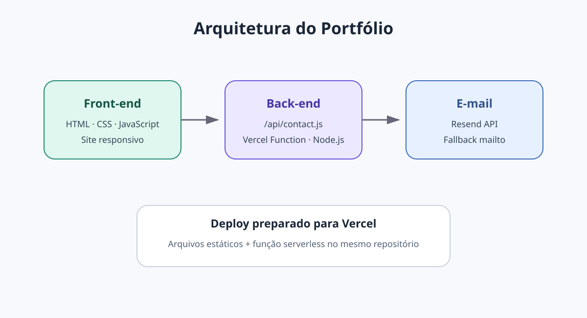

---

## Protótipos e wireframes

Os wireframes de média fidelidade estão disponíveis em arquivos SVG, que podem ser importados diretamente no Figma.

| Início / Sobre | Projetos |
|---|---|
| 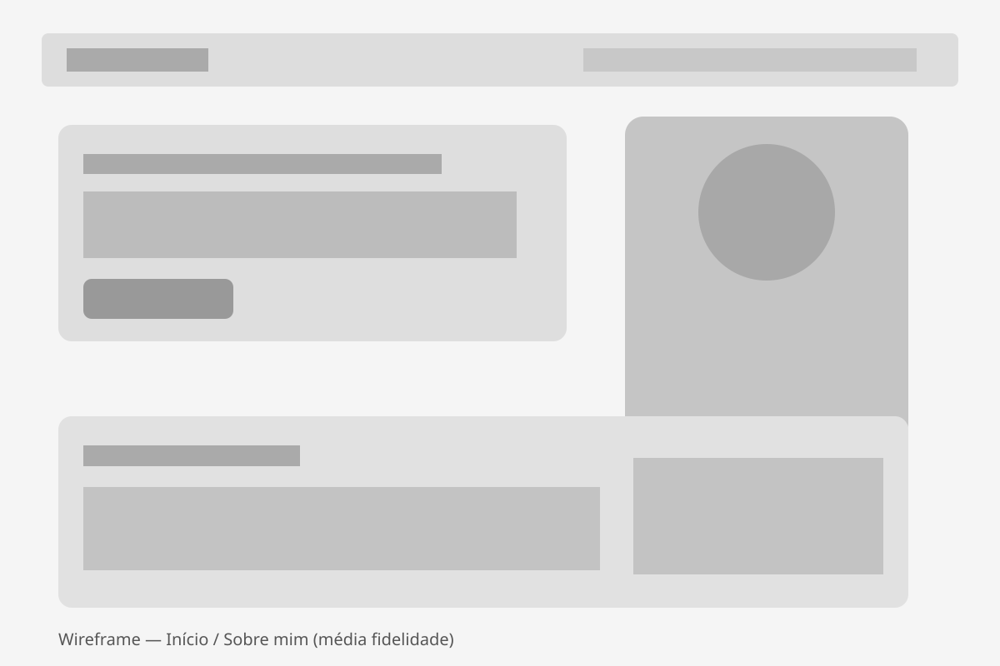 | 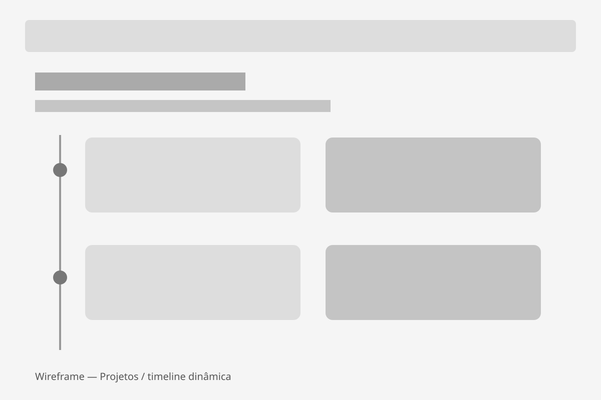 |

| Experiências | Contato |
|---|---|
| 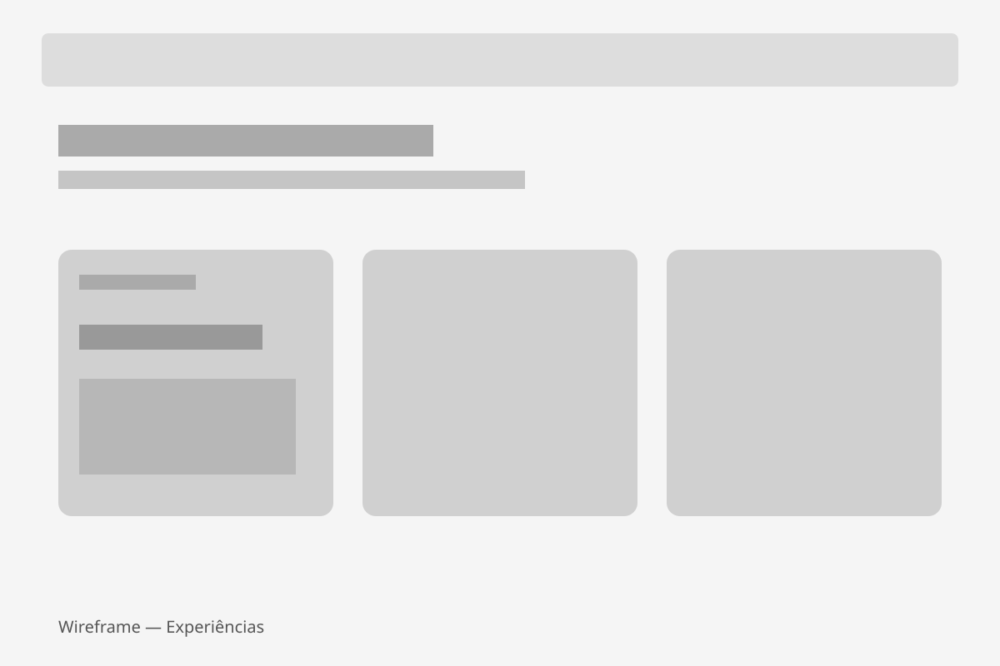 | 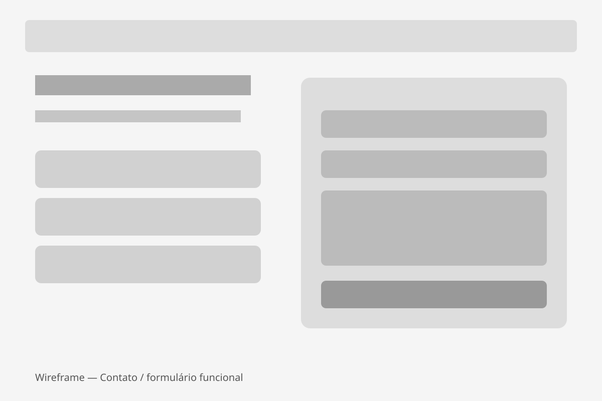 |

Também existe um board com todas as telas:

- [`docs/wireframes/figma-board.svg`](docs/wireframes/figma-board.svg)

O protótipo também está disponível **dentro do Figma**: [https://www.figma.com/design/Ntrx6bs4vuNTF4XjJOJSbd/LAB01---Portf%C3%B3lio-Profissional---Bernardo-Machado?node-id=0-1&t=PpDM1ML3ZNzTKsk0-1](https://www.figma.com/design/Ntrx6bs4vuNTF4XjJOJSbd/LAB01---Portf%C3%B3lio-Profissional---Bernardo-Machado?node-id=0-1&t=PpDM1ML3ZNzTKsk0-1). O board importável permanece em `docs/wireframes/figma-board.svg` para edição e referência. O passo a passo de importação está em [`docs/FIGMA_IMPORT.md`](docs/FIGMA_IMPORT.md).

---

## Instalação e execução

### Pré-requisitos

- Node.js 18 ou superior;
- Git, caso queira clonar o repositório.

### Clonar

```bash
git clone https://github.com/BernardoRibeiro7/portfolio-profissional.git
cd portfolio-profissional
```

### Executar localmente

Não é necessário executar `npm install`, pois não existem dependências obrigatórias.

```bash
npm run dev
```

Acesse:

```text
http://localhost:3000
```

### Variáveis de ambiente opcionais

Copie `.env.example` para `.env` caso queira testar o envio direto por e-mail.

```env
RESEND_API_KEY=sua_chave
CONTACT_TO_EMAIL=ribeiromachadobernardo@gmail.com
CONTACT_FROM_EMAIL=Portfolio Bernardo <onboarding@resend.dev>
```

Sem `RESEND_API_KEY`, o formulário permanece utilizável pelo fallback do aplicativo de e-mail.

---

## Deploy na Vercel

O projeto já contém `vercel.json` e a função serverless em `api/contact.js`.

Passos resumidos:

1. envie o conteúdo do projeto para `BernardoRibeiro7/portfolio-profissional`;
2. abra a Vercel e escolha **Add New → Project**;
3. importe o repositório;
4. mantenha o diretório raiz do projeto;
5. use **Other** como Framework Preset, se necessário;
6. clique em **Deploy**;
7. opcionalmente configure `RESEND_API_KEY`, `CONTACT_TO_EMAIL` e `CONTACT_FROM_EMAIL`;
8. faça redeploy se adicionar variáveis;
9. copie a URL final e substitua `ADICIONE_AQUI_O_LINK_DA_VERCEL_APÓS_O_DEPLOY` neste README.

Detalhes: [`DEPLOY_VERCEL.md`](DEPLOY_VERCEL.md).

---

## Estrutura de pastas

```text
portfolio-profissional/
├── api/
│   └── contact.js
├── assets/
│   ├── css/
│   │   └── styles.css
│   └── js/
│       └── main.js
├── docs/
│   ├── screenshots/
│   │   ├── site-desktop.png
│   │   └── site-mobile.png
│   ├── wireframes/
│   │   ├── 01-home-sobre.svg
│   │   ├── 02-projetos.svg
│   │   ├── 03-experiencias.svg
│   │   ├── 04-contato.svg
│   │   └── figma-board.svg
│   ├── architecture.svg
│   ├── FIGMA_IMPORT.md
│   └── REQUIREMENTS_CHECKLIST.md
├── lib/
│   └── contact.js
├── public/
│   ├── favicon.svg
│   ├── images/
│   │   ├── bernardo.jpg
│   │   └── bernardo-original.jpeg
│   └── projects/
│       ├── java-basico.png / .svg
│       ├── login-puc.png / .svg
│       ├── lab-programacao.png / .svg
│       └── portfolio.png / .svg
├── .env.example
├── .gitignore
├── DEPLOY_VERCEL.md
├── index.html
├── LICENSE
├── package.json
├── README.md
├── server.js
└── vercel.json
```

---

## Demonstração

### Desktop


### Mobile

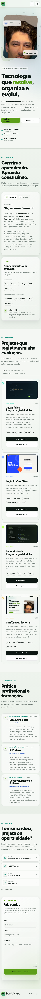

### Projetos exibidos

#### Java Básico — Programação Modular

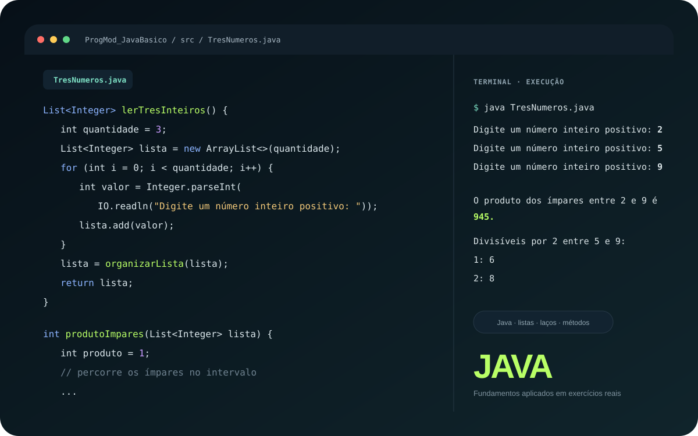

#### Login PUC — DIAW

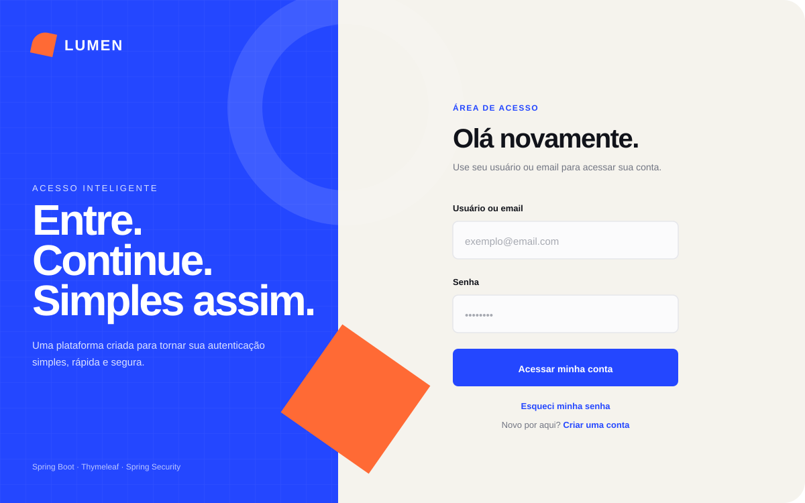

#### Laboratório de Programação Modular

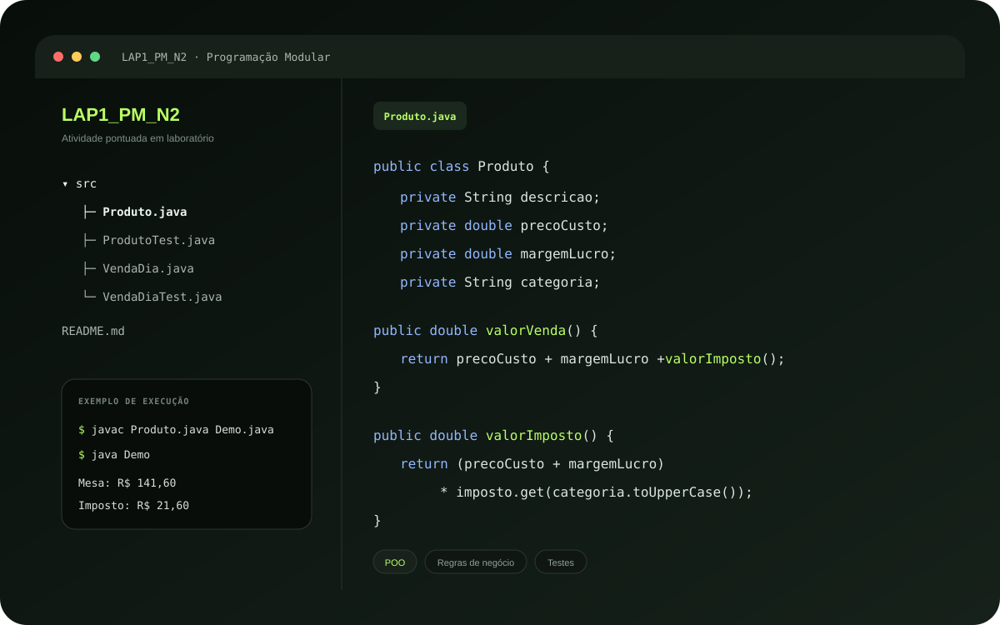

#### Portfólio Profissional

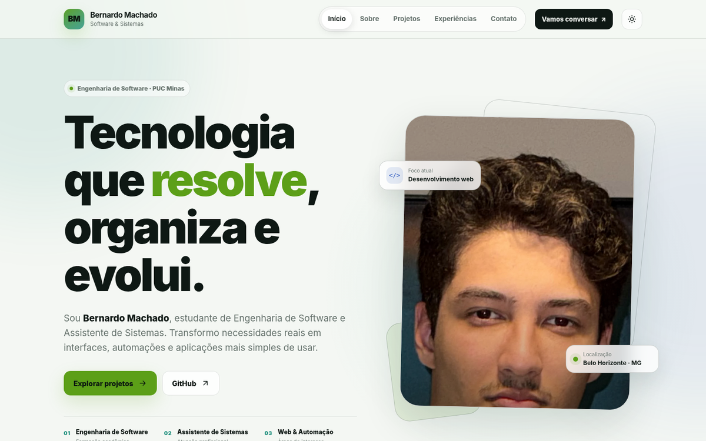

---

## Testes e validações

### Sintaxe JavaScript

```bash
npm run check
```

O comando valida:

- `server.js`;
- `api/contact.js`;
- `lib/contact.js`;
- `assets/js/main.js`.

### Testes locais realizados

- carregamento do HTML;
- carregamento do CSS;
- carregamento das imagens PNG;
- criação dinâmica dos 4 projetos;
- abertura e fechamento do modal de prévia;
- alternância Português / English;
- alternância de tema claro / escuro;
- menu mobile;
- validação visual dos 3 campos obrigatórios do formulário;
- layout desktop e mobile;
- validação do endpoint de contato com entrada inválida;
- carregamento do fallback quando o serviço de e-mail não está configurado;
- verificação de sintaxe dos arquivos JavaScript.

---

## Checklist da atividade

O checklist detalhado está em [`docs/REQUIREMENTS_CHECKLIST.md`](docs/REQUIREMENTS_CHECKLIST.md).

**Estado do código:** todos os requisitos implementáveis dentro do repositório estão concluídos.

**Passos externos / dados restantes para 100% literal do enunciado:**

1. informar a URL real do LinkedIn para adicionar ao bloco de contato;
2. publicar na Vercel e adicionar a URL final ao README.

O protótipo no Figma já foi criado e vinculado ao README. O LinkedIn não foi inventado porque o perfil real não foi informado. O deploy na Vercel será realizado pelo próprio autor.

---

## Autor

**Bernardo Machado**

- GitHub: https://github.com/BernardoRibeiro7
- Instagram: https://instagram.com/be.machado_
- E-mail: ribeiromachadobernardo@gmail.com
- WhatsApp: +55 31 99395-4991

---

## Licença

Este projeto está disponibilizado sob a licença MIT para fins acadêmicos e de portfólio.
